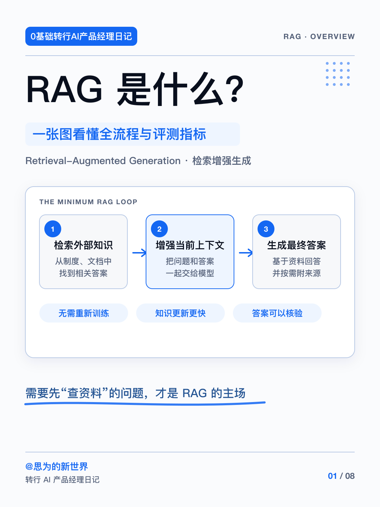
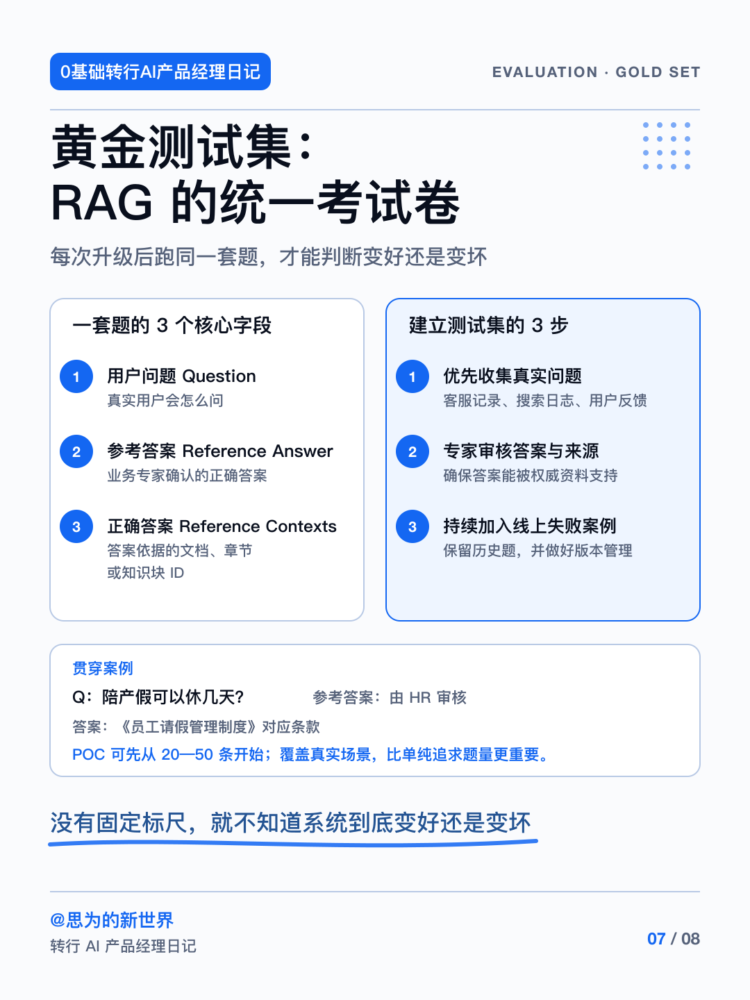
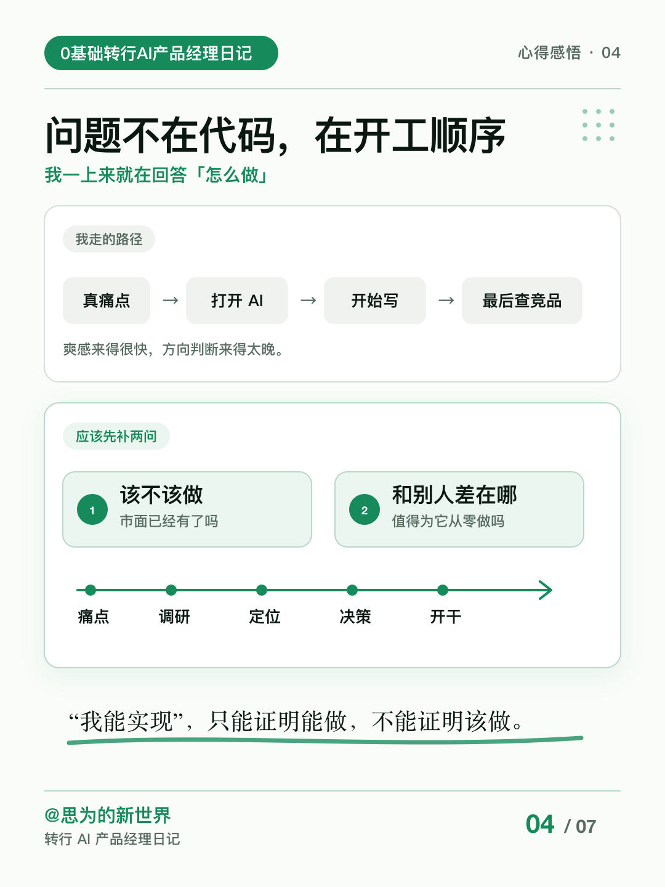

# 小红书知识卡片技能

这是一个可移植的通用 Agent Skill，用于把散碎信息、专业笔记、深度经验或复盘草稿，整理成结构清晰、适合手机阅读的小红书 3:4 干货知识卡片。

核心目录遵循 [Agent Skills 开放标准](https://agentskills.io/home)。兼容该标准的 Agent 可以直接安装；支持项目规则、知识文件或自定义指令的其他 Agent，也可以读取同一套 `SKILL.md`、参考资料和视觉资产执行工作流。

## 通用配置

- 使用前会提示用户填写自己的博主署名与内容类别。未填写时，Skill 会生成与帖子主题相关的英文角标；明确要求留空时保持空白。Skill 不会默认套用作者账号。
- 主色优先由用户指定；未指定时，知识科普使用经典科技蓝，经验复盘使用成长绿。
- 默认画布为 `1080×1440px`，比例 `3:4`。
- 视觉基调可选科技严谨、经验分享、避坑警告或轻松干货。

## 能力

- 第一轮只确认 10 个内容问题、品牌署名、系列名称、主题色和尺寸，并等待用户回答。
- 按知识单元动态规划 3–7 张，不为凑页重复内容。
- 收到回答后，同时输出完整内容方案与 P1/P2 实际样图；确认后再批量生成剩余页面。
- 功能性图标统一使用 Lucide 线性图标库。
- 控制单页信息量、三级文字层级、留白、页码和可选署名。
- 完成逐页视觉检查，并生成标题、正文、标签和评论引导。

## 效果示例

### 经典科技蓝｜知识科普

| 封面 | 内页 |
| --- | --- |
|  |  |

### 温和成长绿｜经验复盘

| 封面 | 内页 |
| --- | --- |
|  |  |

四张图片保留作者此前使用本工作流生成的真实案例，因此画面中带有作者自己的署名与栏目名称。它们只用于展示可达到的视觉效果，不是 Skill 的默认输出。其他用户运行时应填写自己的署名、账号昵称或系列名称。

## 兼容方式

| Agent 产品 | 使用方式 | 兼容级别 |
| --- | --- | --- |
| [Codex](https://developers.openai.com/api/docs/guides/tools-skills) | 安装 `skill/` 目录，由 Agent 自动触发或显式调用 | 原生 Skill |
| ChatGPT Skills | 在支持 Skills 的工作区上传技能包，具体入口取决于账号和工作区设置 | 原生导入 |
| [Claude Code](https://code.claude.com/docs/en/skills) | 将 `skill/` 复制到 `~/.claude/skills/xhs-card-designer` | 原生 Skill |
| [WorkBuddy](https://www.workbuddy.cn/docs/workbuddy/From-Beginner-to-Expert-Guide/Function-Description/Skills-Market) | 下载 [Skill ZIP](dist/xhs-card-designer.zip)，在 Skills 页面导入本地技能包 | 原生导入 |
| [TRAE](https://docs.trae.cn/ide_rules) | 通过 `.trae/rules/`、`AGENTS.md` 或 `CLAUDE.md` 指示 Agent 读取 `skill/SKILL.md` | 规则适配 |
| 其他 Agent | 将 `skill/SKILL.md` 及其引用的 `references/`、`assets/` 加入项目知识或会话上下文 | 手动适配 |

当前版本在 Codex 中完成开发与全流程验证，因此 Codex 是首选运行环境，自动触发、分阶段确认、本地渲染与文件审查的完成度最高。其他 Agent 可按上表使用，但受工具、上下文和渲染能力差异影响，版式一致性与成图质量可能略低，建议先确认 P1/P2 样板，再批量生成整套图片。

不同产品的自动发现目录、触发语法和工具权限并不相同。没有开放本地 Skill 导入的对话产品，可以上传 Markdown 文件作为项目知识或自定义指令，但不能保证获得本地渲染、批量导图和自动调用能力。

## 安装

### Codex

```bash
cp -R skill ~/.codex/skills/xhs-card-designer
```

重启 Codex 或开启新任务后调用：

```text
Use $xhs-card-designer 把这份内容整理成一套小红书干货知识卡片。
```

### Claude Code

```bash
cp -R skill ~/.claude/skills/xhs-card-designer
```

随后输入 `/xhs-card-designer`，或直接描述需要生成小红书知识卡片的任务。

### WorkBuddy

下载 [xhs-card-designer.zip](dist/xhs-card-designer.zip)，在 Skills 页面选择添加技能并上传。压缩包根目录包含 `SKILL.md`。

### 规则型或通用 Agent

把仓库加入 Agent 可读取的项目目录，并使用以下指令：

```text
读取 skill/SKILL.md，并严格执行三个检查点：先提问并等待；收到答案后交付完整内容与 P1/P2 样图；确认后再生成剩余页面。
```

## 使用前提

目标 Agent 需要具备图像生成能力，或能够运行 HTML/SVG 等本地渲染工具。Skill 不内置第三方字体、平台 API 密钥或发布自动化。纯文本 Agent 仍可完成内容规划、逐页文案、生成提示词和质量审查，但不能直接交付 PNG。

## 目录

```text
.
├── README.md
├── LICENSE
├── NOTICE.md
├── dist/
│   └── xhs-card-designer.zip
├── examples/
│   ├── blue-cover.png
│   ├── blue-inner.png
│   ├── green-cover.png
│   └── green-inner.png
└── skill/
    ├── SKILL.md
    ├── agents/openai.yaml
    ├── assets/style-reference.svg
    └── references/
        ├── production-workflow.md
        ├── visual-system.md
        └── quality-gate.md
```

`skill/agents/openai.yaml` 只提供 OpenAI 产品的界面元数据。其他 Agent 可以忽略该文件，不影响标准 `SKILL.md` 工作流。

## 来源与许可

本项目基于 [ziguishian/xhs-visual-director-skill](https://github.com/ziguishian/xhs-visual-director-skill) 修改，并围绕通用配置、10 问需求对齐、动态分页、P1/P2 样板确认和质量门槛重新设计。详见 [NOTICE.md](NOTICE.md)。

本仓库公开版内容按 [MIT License](LICENSE) 发布。上游版权与许可声明已保留在 [NOTICE.md](NOTICE.md) 中。
